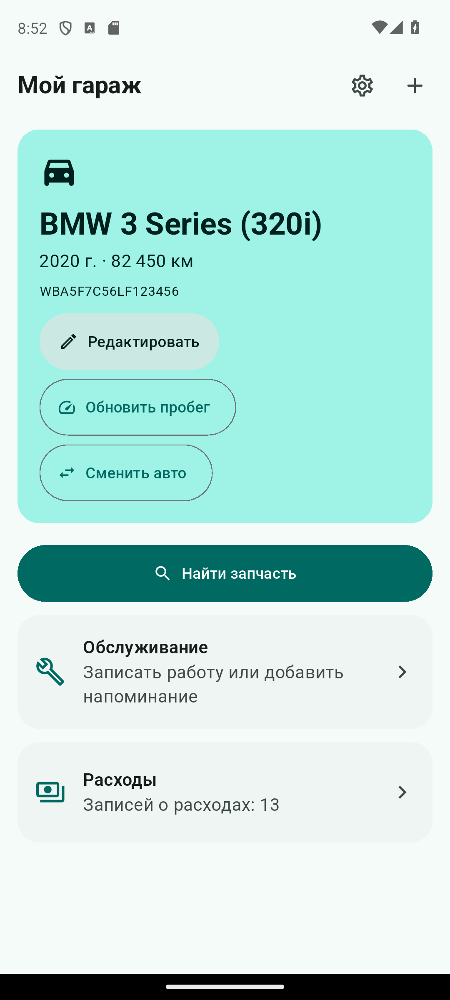
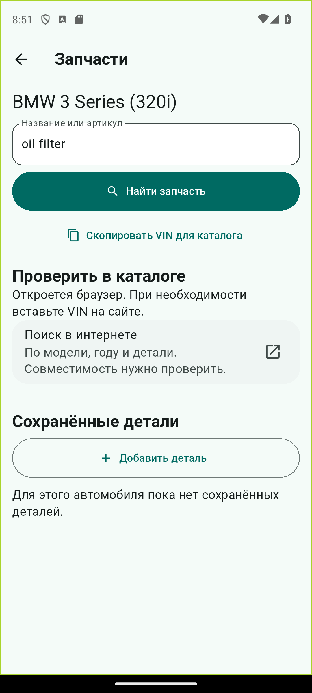
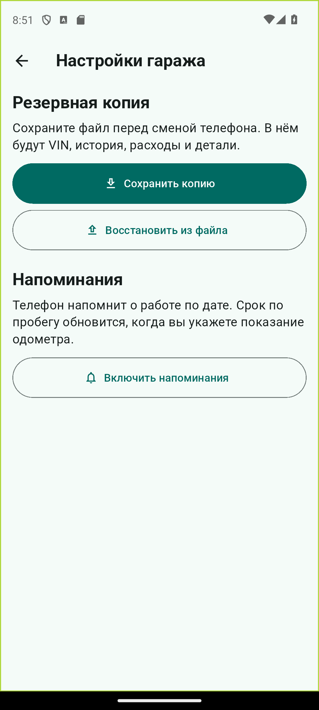

# Car Care Assistant

**Вся история машины под рукой.**

Личный гараж для водителя: следующее ТО, нужный артикул и расходы в одном месте.

[Скачать APK для Android 6.0+](https://github.com/Mori2282/Car-Care-Assistant/releases/latest) · [Что умеет поиск](#поиск-запчастей) · [Сборка для Android](docs/android.md)

| Гараж | Обслуживание | Запчасти |
| --- | --- | --- |
| Добавьте машину по VIN, номеру кузова или вручную. | Задайте интервал по пробегу или дате и запишите выполненные работы. | Введите название или номер детали и сохраните артикул под выбранным авто. |

Для журнала, расходов и сохранённых деталей интернет не нужен. Записи хранятся на телефоне. В настройках гаража можно сохранить резервную копию и перенести её на другой телефон. Расходы в разных валютах учитываются отдельно.

В настройках гаража можно выбрать светлую, тёмную или системную тему. Выбранная тема сохраняется после перезапуска.

  
  
  

## Поиск запчастей

1. Откройте гараж и выберите машину.
2. Нажмите **«Найти запчасть»**. Введите название, например «масляный фильтр», или оригинальный артикул.
3. Проверьте результат каталога или откройте подходящий справочник.
4. Сохраните деталь и скопируйте артикул для магазина или мастера.

В стандартной сборке автозаполнение по VIN использует NHTSA vPIC, ориентированный на рынок США. Если полной расшифровки нет, приложение проверяет международный код производителя (WMI). Для японского номера кузова (FRAME) приложение предлагает открыть подходящий справочник или может запросить подключённый каталог. Если VIN не распознался, добавьте машину вручную и укажите рынок и двигатель, если они известны. Поиск в подключённом каталоге может подтвердить совместимость только для конкретной модификации. Ссылки в браузере и совпадение по артикулу требуют самостоятельной проверки.

## Для разработчиков

- [Сборка, тесты и подготовка к Google Play](docs/android.md)
- [Контракт каталога и проверка покрытия VIN](docs/catalog.md)
- [Какие данные использует приложение](docs/privacy.md)
